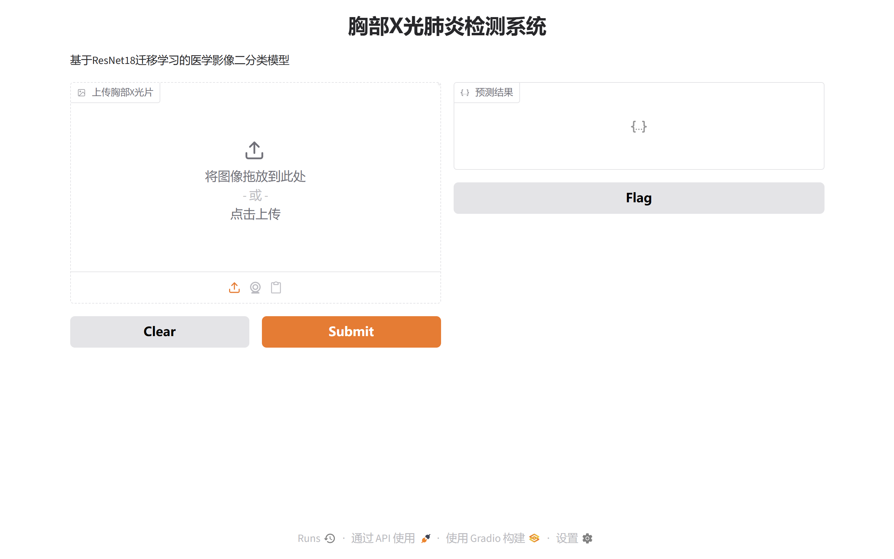

# Chest X-ray Pneumonia Detection / 胸部X光肺炎检测（二分类）

A PyTorch chest X-ray binary classifier (Normal / Pneumonia) based on ResNet-18 transfer learning. It covers data augmentation, class-imbalance handling, training, full evaluation, Grad-CAM explainability, and a local Gradio demo.

基于 ResNet-18 迁移学习的胸部X光二分类器（正常 / 肺炎），覆盖数据增强、类别不平衡处理、模型训练、全量评估、Grad-CAM 可解释性与本地 Gradio 演示。

> For algorithm learning and demonstration only; output is not a medical diagnosis.
> 本项目仅用于算法学习与演示，输出不构成医疗诊断，不能替代专业医师判断。

## Demo Preview / 演示界面



Local Gradio web page: upload a chest X-ray to get the prediction and confidence.
本地 Gradio 网页：上传胸部X光片即可获得预测结果与置信度。

## Tech Stack / 技术栈

- **Framework / 框架**: PyTorch + TorchVision
- **Backbone / 骨干网络**: ResNet-18 transfer learning; optional MobileNetV2 lightweight version (`model_mobile.py`) / ResNet-18 迁移学习，另提供 MobileNetV2 轻量化版本
- **Augmentation / 数据增强**: grayscale normalization, random horizontal flip, random rotation, center crop / 灰度标准化、随机翻转、随机旋转、中心裁剪
- **Imbalance handling / 不平衡处理**: class-weighted cross-entropy, optional WeightedRandomSampler / 类别加权交叉熵，可选过采样
- **Metrics / 评估指标**: Accuracy, Precision, Recall, F1, Confusion Matrix, ROC/AUC / 准确率、精确率、召回率、F1、混淆矩阵、ROC/AUC
- **Explainability / 可解释性**: Grad-CAM heatmaps / Grad-CAM 热力图
- **Demo / 演示**: local Gradio web page / 本地 Gradio 网页

## Dataset / 数据集

Kaggle public pediatric chest X-ray pneumonia dataset (Chest X-Ray Images / Pneumonia), 5863 labeled images split into train / val / test.

采用 Kaggle 公开儿童胸部X光肺炎数据集，共 5863 张标注胸片，已划分 train / val / test。

- Classes / 类别: binary (Normal / Pneumonia) / 二分类（正常 / 肺炎）
- The dataset is large and **not included in this repository**; download from Kaggle and place as:

数据集较大，**不纳入仓库**，请从 Kaggle 下载后按以下结构放置：

```
chest_xray/
├── train/
│   ├── NORMAL/
│   └── PNEUMONIA/
├── val/
│   ├── NORMAL/
│   └── PNEUMONIA/
└── test/
    ├── NORMAL/
    └── PNEUMONIA/
```

## Training Summary / 训练概况

- Epochs / 轮数: 10; Device / 设备: CPU
- Class counts / 各类样本数: NORMAL 1341, PNEUMONIA 3875
- Class weights / 类别权重: Normal 1.945, Pneumonia 0.673（inverse-frequency weighting / 反比频率加权）
- Best validation accuracy / 最佳验证准确率: 100.00%（验证集仅 16 张，仅供参考；真实表现以测试集为准 / val set has only 16 images, treat as reference only; rely on test set）

## Results / 实验结果

Test set results (624 images) from `python test_evaluation.py`.
测试集结果（624 张），由 `python test_evaluation.py` 得出。

| Metric / 指标 | Weighted Model / 加权模型 | Baseline / 基线 |
|---|---|---|
| Test Accuracy / 测试准确率 | 85.58% | 84.46% |
| Pneumonia Precision / 肺炎精确率 | 0.8138 | 0.8021 |
| Pneumonia Recall / 肺炎召回率 | 0.9974 | 0.9974 |
| F1 Score / F1 分数 | 0.8963 | 0.889 |
| AUC | 0.9705 | 0.9723 |

> Class-weighted loss slightly improves Accuracy / Precision / F1 while keeping near-perfect recall; AUC remains ~0.97.
> 类别加权后准确率、精确率、F1 小幅提升，召回率接近满分，AUC 维持在 0.97 左右。

## Visualization / 可视化

### 1. Confusion Matrix / 混淆矩阵


### 2. ROC Curve / ROC 曲线


### 3. Sample Predictions / 测试样例预测


### 4. Grad-CAM Comparison / Grad-CAM 对比


Green = correct, red = wrong; heatmap highlights the lung regions the model relies on.
绿色=预测正确，红色=预测错误；热力图标注模型判断所依赖的肺部区域。

## Quick Start / 快速开始

### 1. Install dependencies / 安装依赖
```bash
pip install -r requirements.txt
```

### 2. Train / 训练（含类别加权）
```bash
python train.py
```
- `USE_CLASS_WEIGHT=True`: class-weighted cross-entropy / 类别加权交叉熵
- `USE_SAMPLER=True`: oversampling (use either, not both) / 过采样（与加权二选一）
- Best checkpoint → `checkpoints/best_model.pth` / 最佳权重保存至该路径

### 3. Full test & evaluation / 全量测试评估
```bash
python test_evaluation.py
```
Outputs Accuracy / Precision / Recall / F1 and generates charts.
输出准确率、精确率、召回率、F1 并生成图表。

### 4. Single-image inference / 单张推理
```bash
python infer.py
```

### 5. Grad-CAM
```bash
python grad_cam_batch.py        # batch heatmaps → heatmap/ / 批量生成热力图
python make_heatmap_montage.py  # build gradcam_montage.png / 生成对比拼图
```

### 6. Local web demo / 本地网页演示
```bash
python demo.py
```
Open `http://127.0.0.1:7860` / 浏览器打开该地址（local only / 仅本机）。

## Project Structure / 项目结构

```
Medical-Image-Classification-PyTorch
├── dataset.py              # data loading & augmentation / 数据加载与增强
├── model.py                # ResNet18 model / ResNet18 模型
├── model_mobile.py         # MobileNetV2 lightweight / 轻量化模型（可选）
├── train.py                # training (weighting / oversampling) / 训练
├── test_evaluation.py      # full test & metrics / 全量评估
├── infer.py                # single-image inference / 单张推理
├── grad_cam.py             # single-image Grad-CAM / 单张热力图
├── grad_cam_batch.py       # batch Grad-CAM / 批量热力图
├── make_heatmap_montage.py # comparison sheet / 对比拼图
├── demo.py                 # Gradio demo / 网页演示
├── requirements.txt
└── README.md
```

## Done vs Future / 已实现与展望

| Direction / 方向 | Implemented / 已实现 | Future / 展望 |
|---|---|---|
| Class imbalance / 类别不平衡 | weighted loss + optional oversampling / 加权损失+可选过采样 | resampling comparison, Focal Loss / 重采样对比、Focal Loss |
| Lightweight model / 轻量化 | MobileNetV2 version / MobileNetV2 版本 | quantization, edge deployment / 量化、边缘部署 |
| Explainability / 可解释性 | Grad-CAM | Grad-CAM++, layer comparison |
| Task extension / 任务扩展 | binary baseline / 二分类基线 | multi-label, U-Net segmentation / 多标签、病灶分割 |

## Disclaimer / 免责声明
For algorithm learning and demonstration only; not a medical diagnosis.
仅用于算法学习与技术演示，不构成医疗诊断，不能替代专业医师。