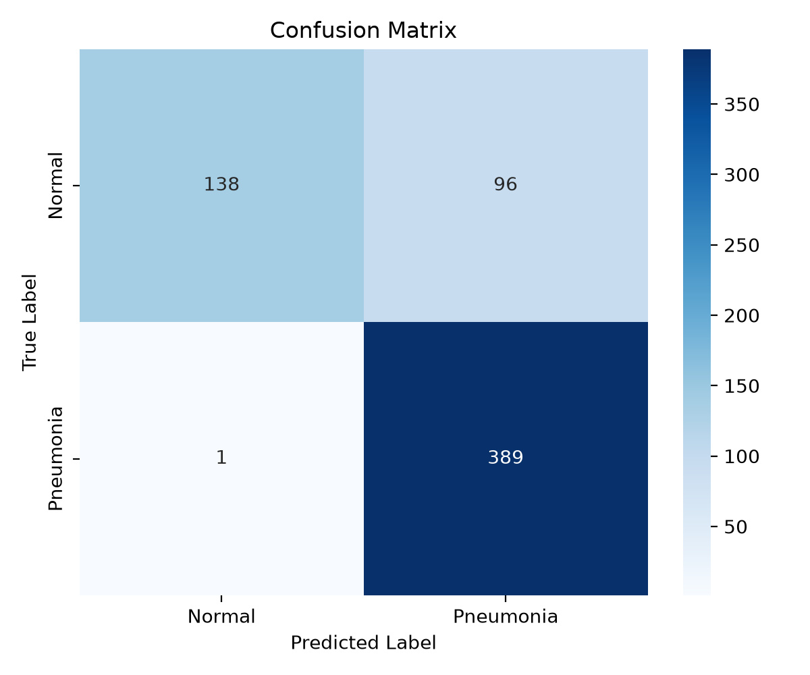
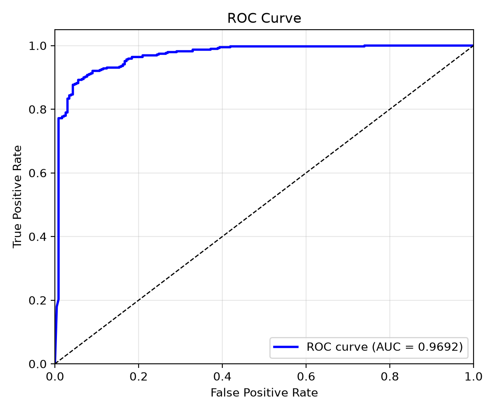
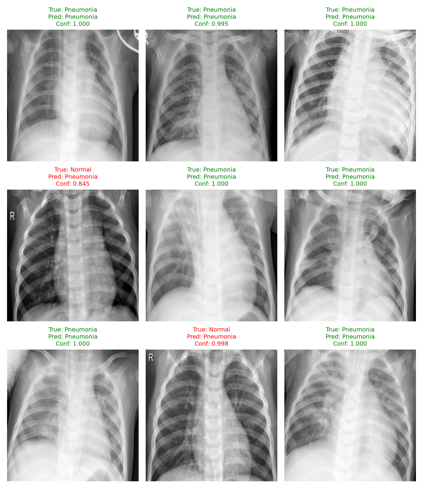
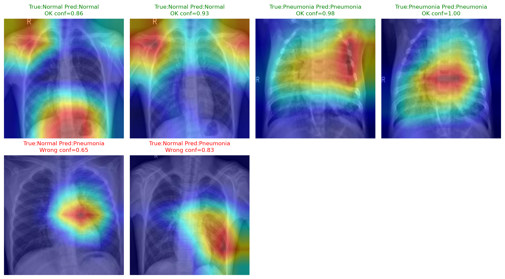

# 医学影像二分类：胸部X光肺炎检测

基于 PyTorch 实现的胸部 X 光影像智能分类系统，采用 ResNet-18 迁移学习完成正常 / 肺炎胸片二分类，覆盖数据增强、类别不平衡处理、模型训练、全量评估、可解释性可视化与本地网页演示全流程，可快速迁移至其他医学影像分类场景。

## 项目背景

针对医学影像小样本与类别不平衡场景，使用 ImageNet 预训练卷积神经网络进行迁移学习，聚焦儿童胸部 X 光片的肺炎病灶检测。项目不用于临床诊断，仅作为计算机视觉算法学习与工程化演示。

## 技术栈

- **深度学习框架**：PyTorch + TorchVision
- **骨干模型**：ResNet-18 迁移学习（另提供 MobileNetV2 轻量化版本 `model_mobile.py`）
- **数据处理**：灰度图标准化、随机翻转、随机旋转、中心裁剪
- **不平衡处理**：类别加权交叉熵损失 / WeightedRandomSampler 过采样
- **评估指标**：准确率、精确率、召回率、F1、混淆矩阵、ROC/AUC
- **可解释性**：Grad-CAM 热力图
- **交互演示**：Gradio 本地网页

## 数据集

采用 Kaggle 公开儿童胸部 X 光肺炎数据集（Chest X-Ray Images / Pneumonia），共 5863 张标注胸片，已划分 train / val / test。

- 类别：二分类（Normal 正常 / Pneumonia 肺炎）
- 标注来源：广州妇女儿童医疗中心，放射科医生校验
- 目录结构：

```
chest_xray/
├── train/
│   ├── NORMAL/
│   └── PNEUMONIA/
├── val/
│   ├── NORMAL/
│   └── PNEUMONIA/
└── test/
    ├── NORMAL/
    └── PNEUMONIA/
```

> 数据集体积较大，不纳入仓库，请从 Kaggle 自行下载后按上述结构放置。

## 实验结果（基线模型）

| 指标 | 数值 |
|---|---|
| 测试集准确率 | 84.46% |
| 肺炎精确率 | 80.21% |
| 肺炎召回率 | 99.74% |
| F1 分数 | 0.889 |
| AUC | 0.9723 |

> 基线模型对肺炎漏检率极低，但因类别不平衡，正常胸片存在一定假阳性；启用类别加权损失后两类判定更均衡。

### 可视化结果

#### 1. 混淆矩阵


肺炎样本几乎全部正确识别，正常样本存在部分假阳性，主要由训练集类别不平衡导致。

#### 2. ROC 曲线


AUC = 0.9723，模型在不同置信度阈值下均具备优秀的二分类判别能力。

#### 3. 测试样例预测


随机抽取 9 张测试图像，绿色为预测正确、红色为预测错误，标注真实标签与模型置信度。

#### 4. Grad-CAM 可解释性


热力图标注模型判断时关注的肺部区域，验证模型依据病灶区域而非背景做出判断。

## 快速开始

### 1. 安装依赖
```bash
pip install -r requirements.txt
```

### 2. 训练模型（含类别加权）
```bash
python train.py
```
- `USE_CLASS_WEIGHT=True`：启用类别加权交叉熵损失，缓解类别不平衡
- `USE_SAMPLER=True`：启用过采样（与加权二选一，避免双重放大）
- 自动保存验证集准确率最高的权重至 `checkpoints/best_model.pth`

### 3. 全量测试与评估
```bash
python test_evaluation.py
```
输出准确率、精确率、召回率、F1，并生成混淆矩阵、ROC 曲线、样例预测图。

### 4. 单张图像推理
```bash
python infer.py
```
修改脚本内图片路径即可对单张胸片预测。

#### 5. Grad-CAM 可解释性

```bash
python grad_cam_batch.py        # batch: save all heatmaps to heatmap/
python make_heatmap_montage.py  # build gradcam_montage.png for README
```
Grad-CAM 热力图标注模型判断时关注的肺部区域：绿色为预测正确、红色为预测错误，
可直观验证模型依据病灶区域而非背景做出判断。


### 6. Grad-CAM 热力图
```bash
python grad_cam.py
```

### 7. 本地网页演示
```bash
python demo.py
```
浏览器打开 `http://127.0.0.1:7860`，上传胸片即可查看预测结果（仅本机访问，不创建公网隧道）。

## 项目结构

```
Medical-Image-Classification-PyTorch
├── dataset.py            # 数据加载与增强
├── model.py              # ResNet18 迁移学习模型
├── model_mobile.py      # MobileNetV2 轻量化模型（可选）
├── train.py              # 训练主脚本（类别加权 / 过采样）
├── test_evaluation.py    # 全量测试与指标评估
├── infer.py              # 单张图像推理
├── grad_cam.py           # Grad-CAM 可解释性可视化
├── demo.py               # Gradio 本地网页演示
├── requirements.txt      # 依赖包
└── README.md
```

## 已做优化与后续方向

| 方向 | 本项目已实现 | 后续可扩展 |
|---|---|---|
| 类别不平衡 | 类别加权损失 + 可选过采样 | 重采样策略对比、Focal Loss |
| 模型轻量化 | 提供 MobileNetV2 版本 | 量化 / 蒸馏、边缘端部署 |
| 可解释性 | Grad-CAM 热力图 | Grad-CAM++、对比不同层 |
| 任务扩展 | 二分类基线 | 14 类多标签（ChestX-ray14）、U-Net 病灶分割 |

## 免责声明

本项目仅用于算法学习与技术演示，输出结果不构成任何医疗诊断依据，不能替代专业医师判断。